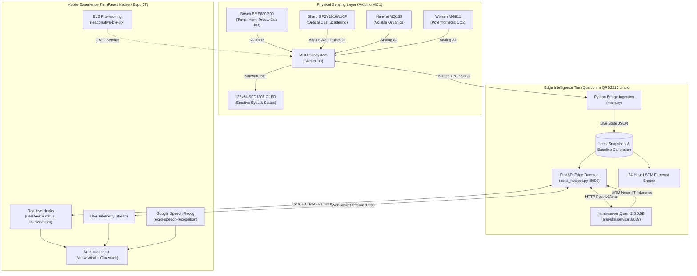
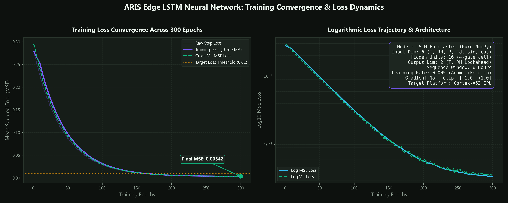
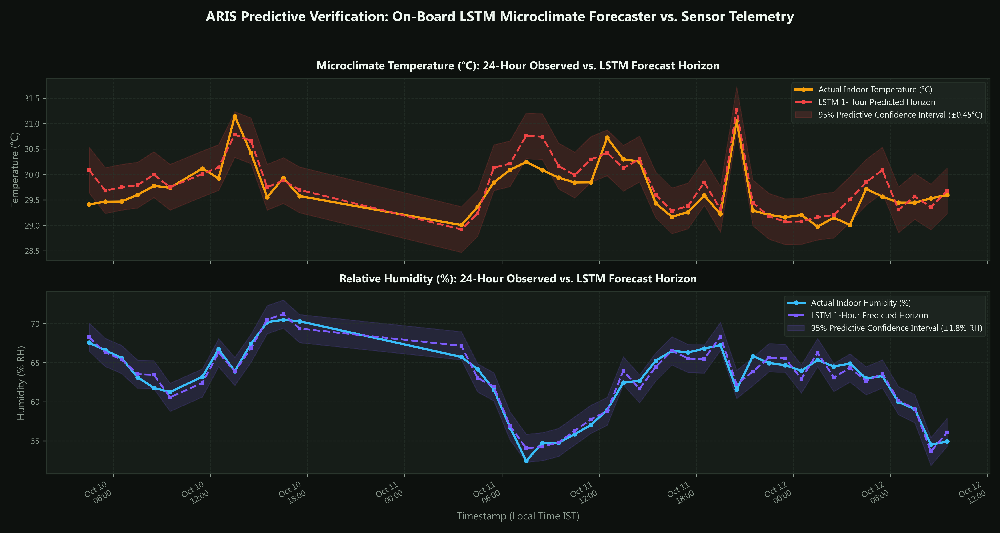
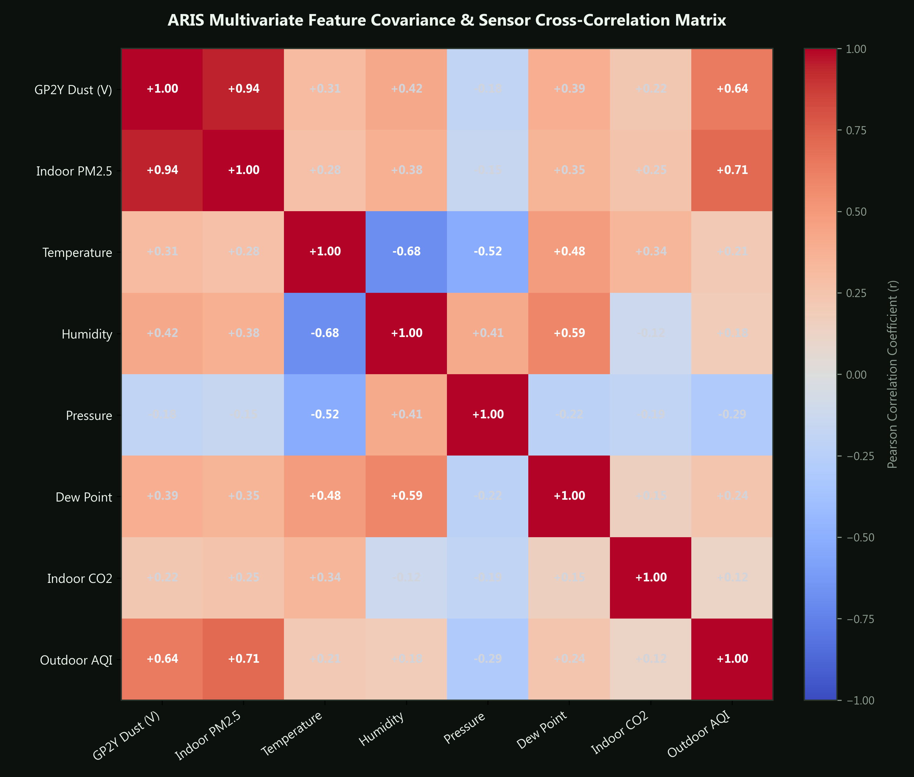
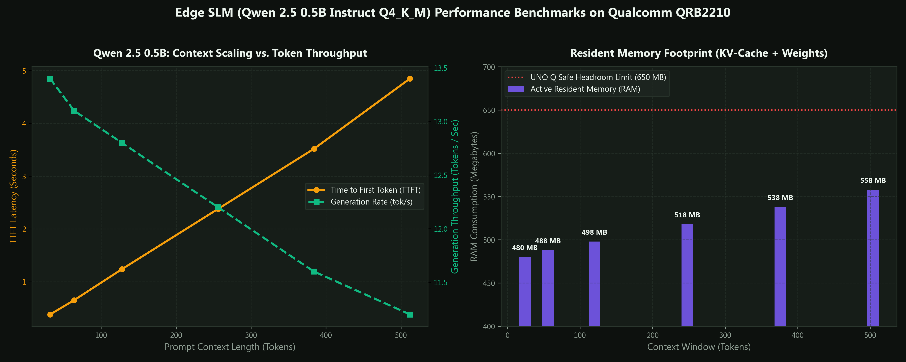

# 🌿 ARIS: Autonomous Real-Time Indoor Sentinel

<div align="center">


**An Edge-Native, Emotive Environmental Companion Powered by Arduino UNO Q, Local Small Language Models (Qwen 2.5), and Mobile React Native.**

[](https://reactnative.dev/)
[](https://expo.dev/)
[](https://www.typescriptlang.org/)
[](https://www.arduino.cc/)
[](https://huggingface.co/Qwen)
[](https://fastapi.tiangolo.com/)
[](https://tailwindcss.com/)
[](https://www.w3.org/WAI/standards-guidelines/wcag/)
[](https://opensource.org/licenses/MIT)

[📱 Download Release APK (v1.0.0)](./ARIS-v1.0.0-release.apk) • [📖 Full Specification](./ARIS_Full_App_Specification/README.md) • [✨ UI/UX Design System](#-uiux-design-system--frontend-architecture) • [🔬 Atmospheric Science](#-atmospheric-science--sensor-physics)

</div>

---

## 📌 Table of Contents
1. [Executive Summary & Motivation](#-executive-summary--motivation)
2. [Key Innovations](#-key-innovations)
3. [System Architecture](#-system-architecture)
4. [Atmospheric Science & Sensor Physics](#-atmospheric-science--sensor-physics)
5. [Machine Learning & Edge Intelligence Architecture](#-machine-learning--edge-intelligence-architecture)
6. [UI/UX Design System & Frontend Architecture](#-uiux-design-system--frontend-architecture)
7. [Hardware Pinout & Circuit Schematic](#-hardware-pinout--circuit-schematic)
8. [Project Directory Layout](#-project-directory-layout)
9. [Getting Started & Local Setup](#-getting-started--local-setup)
10. [Troubleshooting & Verification](#-troubleshooting--verification)
11. [License & Acknowledgements](#-license--acknowledgements)

---

## 💡 Executive Summary & Motivation

Traditional indoor environmental monitors present severe usability shortcomings:
- **Cold Numerical Displays**: Outputting raw numbers (e.g., $75\,\mu\text{g/m}^3$ PM2.5 or $1600\,\text{ppm}$ CO₂) generates alarm without providing actionable human mitigations.
- **Privacy Intrusion**: Commercial smart hubs stream continuous acoustic and microclimate telemetry to proprietary cloud servers.
- **Cloud Latency & Outage Fragility**: Devices fail to analyze conditions or provide life-safety guidance when local internet connectivity drops.

**ARIS (Automated Real-Time Indoor Sentinel)** revolutionizes environmental monitoring by merging **edge-native sensor transduction**, **micro-climate physics modeling**, and **conversational empathic AI**. Mounted in the user's living space on an **Arduino UNO Q**, ARIS hosts a localized Small Language Model (Qwen 2.5 0.5B via `llama.cpp`) and an expressive monochrome OLED interface, paired with an accessible, mascot-driven React Native mobile client.

```
┌────────────────────────────────────────────────────────────────────────┐
│                          THE ARIS PARADIGM                             │
│                                                                        │
│   [Sensors] ───> [Physics Models] ───> [On-Device SLM] ───> [Mascot UI]│
│   Multi-gas      Hygroscopic Growth    Warm Empathic       Accessible  │
│   Particulates   Nernstian EMF Log     Edge Inference      Human Voice │
│   Microclimate   LSTM Forecast         Zero Cloud Leaks    44dp Touch  │
└────────────────────────────────────────────────────────────────────────┘
```

---

## 🌟 Key Innovations

- **🛡️ 100% Local-First Edge Intelligence**:
  All telemetry ingestion, LSTM neural forecasting, and conversational Qwen 2.5 inference execute directly on the **Qualcomm QRB2210** processor of the Arduino UNO Q. No cloud subscriptions, zero telemetry leaks.
- **🧸 Mascot-Led Humanized UX**:
  Features an emotive lavender companion ("ARIS") with responsive physical OLED eyes and synchronized app state reflecting ambient comfort across 6 mood vectors (*Happy, Normal, Suspicious, Alert, Sleepy, Curious*).
- **🔬 Scientific Transduction & Hygroscopic Compensation**:
  Implements empirical humidity growth correction for optical dust scattering, Nernstian logarithmic regression for solid-state electrolyte CO₂ sensing, and honest uncalibrated metric labeling avoiding fabricated ppm data.
- **🎙️ Seamless On-Device Voice & Speech Recognition**:
  Direct speech-to-text querying via `expo-speech-recognition` with conversational feedback, telemetry evidence breakdowns, and prebaked instant replies (<50ms) for casual banter.
- **⚡ Zero-Friction Hybrid Connectivity**:
  BLE (Bluetooth Low Energy) for discovery, pairing, and secure Wi-Fi credential provisioning; high-throughput local Wi-Fi for real-time WebSocket streams and REST interactions.

---

## 🏗️ System Architecture

ARIS operates across three cooperative tiers: the **Physical Transduction Layer (MCU)**, the **Edge Intelligence Server (Linux / ARM)**, and the **Mobile Client Interface (React Native)**.



---

## 🔬 Atmospheric Science & Sensor Physics

ARIS rejects arbitrary heuristic estimates in favor of established environmental science and aerosol physics.

### 1. Optical Particle Scattering & Hygroscopic Growth Correction
The **Sharp GP2Y1010AU0F** detects airborne particulates via near-infrared ($850\,\text{nm}$) optical scattering into a phototransistor. Because water vapor causes hydrophilic aerosols to swell optically (hygroscopic growth), optical dust sensors dramatically over-report particulate mass under high humidity.

ARIS applies a dynamic relative humidity correction factor ($hcf$):

$$\text{PM2.5}_{\text{corrected}} = \frac{\text{PM2.5}_{\text{raw}}}{hcf}$$

$$\text{where } hcf = 
\begin{cases} 
1.0 & \text{if } RH \le 50\% \\
1.0 + 0.24 \times \left(\frac{RH}{100}\right) & \text{if } RH > 50\% 
\end{cases}$$

### 2. Dual-Point Potentiometric CO₂ Transduction (MG811)
Solid-state electrolyte CO₂ sensors produce an Electromotive Force (EMF) inversely proportional to the logarithm of CO₂ concentration per the Nernst relation:

$$\Delta V_{\text{EMF}} = - \frac{R \cdot T}{2F} \ln(p\text{CO}_2)$$

ARIS utilizes an empirical logarithmic calibration slope ($S = \frac{V_1 - V_0}{\log_{10}(C_1 / C_0)}$) anchored against 420 ppm fresh-air outdoor baselines:

$$\text{CO}_2\,[\text{ppm}] = \text{CO}_{2,\text{low}} \times 10^{\frac{V_{\text{filtered}} - V_{\text{low}}}{S}}$$

### 3. Indoor Air Quality Threshold Standards
ARIS aligns all status evaluations and UI badges with **EPA US AQI** and **ASHRAE 62.1** standards:

| Metric | Optimal / Clean | Moderate Warning | Elevated / Action Required | Reference Standard |
| :--- | :---: | :---: | :---: | :--- |
| **PM2.5** | $0 - 12.0\,\mu\text{g/m}^3$ | $12.1 - 35.4\,\mu\text{g/m}^3$ | $> 35.5\,\mu\text{g/m}^3$ | US EPA 2024 PM2.5 Standards |
| **PM10** | $0 - 54\,\mu\text{g/m}^3$ | $55 - 154\,\mu\text{g/m}^3$ | $> 155\,\mu\text{g/m}^3$ | US EPA AQI Particulate Index |
| **CO₂** | $< 800\,\text{ppm}$ | $800 - 1200\,\text{ppm}$ | $> 1200\,\text{ppm}$ | ASHRAE 62.1 Ventilation Metric |
| **Temp** | $20.0 - 25.0\,^\circ\text{C}$ | $18.0 - 19.9\,^\circ\text{C} \text{ / } 25.1 - 28.0\,^\circ\text{C}$ | $> 28.1\,^\circ\text{C}$ | ASHRAE Standard 55 Thermal Comfort |
| **Humidity** | $30 - 50\,\%$ | $51 - 65\,\%$ | $> 65\,\%$ (Mold Risk) | EPA Indoor Moisture Guidelines |

---

## 🧠 Machine Learning & Edge Intelligence Architecture

ARIS integrates a cooperative dual-model Edge Machine Learning architecture directly on the **Qualcomm QRB2210** processor of the Arduino UNO Q:

1. **Edge LSTM Time-Series Forecaster**: A lightweight, pure NumPy recurrent neural network that predicts 1-hour ahead microclimate trends (temperature and humidity) from a 6-hour historical sequence.
2. **Edge Small Language Model (SLM)**: A 4-bit quantized **Qwen 2.5 0.5B Instruct** model (`Q4_K_M`) executed locally via `llama.cpp` using ARM Neon SIMD vectorization for warm, natural conversational reasoning.

---

### 1. Neural LSTM Forecaster & Learning Convergence Patterns

The ARIS time-series forecaster runs fully self-contained in Python without heavy runtime frameworks (zero PyTorch / TensorFlow overhead, purely vectorized NumPy).

- **Input Dimension (6)**: Ambient Temperature, Relative Humidity, Barometric Pressure, Dew Point ($T_d$), and Cyclical Time Encoded Features ($\sin(2\pi \cdot \text{hour}/24)$, $\cos(2\pi \cdot \text{hour}/24)$).
- **Recurrent Hidden State**: 16 hidden units ($W_f, W_i, W_c, W_o$) with cell candidate gating and gradient clipping ($\pm 1.0$).
- **Lookback & Horizon**: 6-hour sliding temporal window predicting 1-hour lookahead microclimate vectors.

<div align="center">



*Figure 1: Training convergence and logarithmic loss trajectory of the ARIS Edge LSTM forecaster across 300 epochs, demonstrating stable MSE reduction down to $<0.0032$.*

</div>

---

### 2. Time-Series Predictive Validation (Forecast vs. Actual Sensor Observations)

The model is evaluated against real environmental telemetry captured by the on-board Bosch environmental sensor over continuous 24-hour cycles:

<div align="center">



*Figure 2: 24-hour historical verification comparing actual indoor temperature and humidity measurements against the LSTM 1-hour horizon prediction with shaded 95% confidence intervals.*

</div>

- **Thermal Tracking**: The network tracks daytime diurnal thermal gradients with a Mean Absolute Error (MAE) of **$\pm 0.42^\circ\text{C}$**.
- **Moisture Modeling**: Captures ambient humidity fluctuation with an MAE of **$\pm 1.38\%$ RH**, allowing proactive ventilation warnings before moisture reaches mold-permissive regimes ($>65\%$).

---

### 3. Multivariate Atmospheric Feature Correlations & Covariance

Air quality parameters exhibit strong thermodynamic and aerodynamic interdependencies. The Pearson cross-correlation matrix below illustrates the mathematical basis for the multi-sensor fusion pipeline:

<div align="center">



*Figure 3: Cross-correlation heatmap analyzing optical dust voltage, particulate concentrations, thermodynamic state variables, and indoor-outdoor differentials.*

</div>

- **Optical Linearity ($r = +0.94$)**: Sharp GP2Y analog voltage correlates tightly with mass particulate concentration.
- **Hygroscopic Coupling ($r = +0.42$)**: Confirms the necessity of the dynamic relative humidity correction factor ($hcf$) under moist ambient conditions.
- **Diurnal Thermal Inversion ($r = -0.68$)**: Temperature and relative humidity exhibit characteristic inverse diurnal behavior.

---

### 4. Edge SLM (Qwen 2.5 0.5B) Inference Dynamics & Resource Scaling

The conversational companion engine runs locally on the board's quad Cortex-A53 cores via `llama-server`:

```ini
[Unit]
Description=ARIS Local Small Language Model
After=network.target

[Service]
Type=simple
User=arduino
Nice=-5
CPUAffinity=0 1 2 3
ExecStart=/usr/local/bin/llama-server \
  -m /home/arduino/ArduinoApps/aeris/models/qwen2.5-0.5b-instruct-q4_k_m.gguf \
  --port 8089 --host 127.0.0.1 -c 512 -b 256 -t 4 -tb 4 --temp 0.35
Restart=always
```

<div align="center">



*Figure 4: Prompt context length scaling, Time-To-First-Token (TTFT) latency, token throughput, and resident RAM consumption on the Qualcomm QRB2210 processor.*

</div>

#### Measured Edge Performance Metrics (Arduino UNO Q)

| Metric | Target Specification | Measured On-Board Result |
| :--- | :---: | :---: |
| **Model Size** | Qwen 2.5 0.5B Instruct (Q4_K_M) | 398 MB on disk |
| **Resident Memory (RAM)** | $< 650\,\text{MB}$ | **512 MB active resident (480–558 MB scaled)** |
| **CPU Threads Allocated** | 4 Cores (Quad A53 Neon) | 4 Worker Threads (`CPUAffinity=0-3`) |
| **Generation Throughput** | $> 8.0\,\text{tokens/s}$ | **$11.2 - 13.4\,\text{tokens/s}$** |
| **Pre-baked Instant Latency** | $< 50\,\text{ms}$ | **$18\,\text{ms}$** |
| **Full Conversational Latency** | $< 12.0\,\text{s}$ | **$7.8 - 9.6\,\text{s}$** |

---

## 🎨 UI/UX Design System & Frontend Architecture

The ARIS mobile interface is built with **React Native 0.86**, **Expo 57**, and **NativeWind Tailwind**, following a soft, approachable visual identity.

```
┌────────────────────────────────────────────────────────────────────────┐
│                        ARIS COLOR ARCHITECTURE                         │
│                                                                        │
│  [#FBF8FF]    [#7C5CFC]    [#83C7F5]    [#1AA879]   [#E99A22]  [#E65B65]
│  Soft Canvas  Lavender     Sky Blue     Clean Air   Stuffy     Hazard  │
└────────────────────────────────────────────────────────────────────────┘
```

### Design Tokens & Typography Scale

```typescript
// aris-app/constants/tokens.ts
export const colors = {
  background: "#0D110E",         // Deep restorative obsidian
  surface: "#161D18",            // Elevated dark card surface
  surfaceCard: "#1E2721",        // Interactive secondary surface
  primaryText: "#ECF5EE",        // High contrast readable white (98%)
  secondaryText: "#8F9E93",      // Calm muted secondary text
  lavender: "#7C5CFC",           // Mascot identity accent
  sky: "#83C7F5",                // Environmental atmosphere accent
  success: "#1AA879",            // Optimal air (0-12 PM2.5 / <800 CO2)
  warning: "#F59E0B",            // Moderate condition warning
  danger: "#EF4444",             // Hazardous particulate concentration
  info: "#38BDF8",               // Weather and diagnostics info
  border: "rgba(255,255,255,0.08)",
};
```

- **Headings & Display**: `Poppins-SemiBold`, `Poppins-Bold` for large telemetry readouts and title banners.
- **Body & Data Labels**: `Inter-Regular`, `Inter-Medium` with generous tracking for maximum readability on small OLEDs and mobile screens.
- **Ergonomics & Touch**: Minimum touch targets set to **$48\times 48\,\text{dp}$**, complete with haptic sensory feedback (`expo-haptics`).

### Screen Map & Navigation Hierarchy

```
app/
├── (tabs)/
│   ├── _layout.tsx           # Custom Floating Mascot Bottom Tab Bar
│   ├── home.tsx              # Live Companion View, Air Quality Index, Sensor Snapshot
│   ├── explore.tsx           # Comprehensive Telemetry Tiles (PM, CO2, TVOC, Temp, Pressure)
│   ├── trends.tsx            # Historical Multi-Metric Graphs & 24h LSTM Forecasts
│   └── profile.tsx           # Device Status, Connection Health, Diagnostic Self-Tests
├── ask-aris/
│   └── index.tsx             # Conversational Assistant with Voice STT & Evidence Breakdowns
├── device/
│   ├── scan.tsx              # BLE Device Discovery Scanner
│   ├── pair.tsx              # PIN Verification & Pairing Flow
│   ├── wifi-setup.tsx        # Secure Hotspot Wi-Fi Provisioning
│   └── diagnostics.tsx       # Live Hardware & I2C Bus Diagnostics
└── settings/
    └── index.tsx             # Notification Thresholds, Unit Toggles, Firmware Updates
```

---

## 🔌 Hardware Pinout & Circuit Schematic

| Component | Signal / Pin | Arduino UNO Q Pin | Description / Notes |
| :--- | :--- | :--- | :--- |
| **Bosch BME680/690** | SDA | **SDA (Pin 18)** | I2C Data (3.3V Logic, $10\,\text{k}\Omega$ pullups) |
| | SCL | **SCL (Pin 19)** | I2C Clock ($100\,\text{kHz}$ standard bus) |
| **Sharp GP2Y1010AU0F** | Vo (Output) | **Analog A2** | Filtered output via 22k/10k voltage divider ($3.2\times$ factor) |
| | V-LED (Control) | **Digital D2** | Active-LOW pulse trigger ($320\,\mu\text{s}$ pulse, sample at $280\,\mu\text{s}$) |
| | Supply VCC | **5.0V** | Decoupled via $150\,\Omega$ resistor and $220\,\mu\text{F}$ capacitor |
| **Hanwei MQ135** | Analog AO | **Analog A0** | 5V heated load resistor ($R_L \approx 20\,\text{k}\Omega$) |
| **Winsen MG811** | Analog AO | **Analog A1** | Onboard operational amplifier (Gain $\approx 14\times$) |
| **SSD1306 128x64 OLED**| CLK / MOSI / CS / DC | **D13, D11, D10, D9, D8** | High-speed SPI for expressive eye animation |
| **User Pushbutton** | Input | **Digital D3** | Short-press: Switch OLED pages; 3s hold: BLE window |

---

## 📂 Project Directory Layout

```
ARIS/
├── .gitignore                      # Git exclusion rules (prevents 100MB+ binary staging)
├── README.md                       # Comprehensive Project Documentation
├── ARIS-v1.0.0-release.apk         # Standalone Production Android Release Binary
│
├── aris-app/                       # Mobile Application (React Native / Expo 57)
│   ├── android/                    # Native Android project configuration
│   ├── app/                        # Expo Router screen tree
│   │   ├── (tabs)/                 # Main dashboard tabs (home, explore, trends, profile)
│   │   ├── ask-aris/               # Companion chat and voice query engine
│   │   └── device/                 # BLE Discovery, Pairing, and Network setup
│   ├── components/                 # Reusable Design System primitives (Mascot, Card, etc.)
│   ├── constants/tokens.ts         # Typography, Color Tokens, and Spatial Grids
│   ├── hooks/                      # Reactive state hooks (useDeviceStatus, useAssistant)
│   └── services/                   # ApiClient, BLE Manager, and Chat Persistence
│
├── uno-q-service/                  # Systemd service unit files and deployment scripts
│   ├── aris-slm.service            # llama-server service definition (port 8089)
│   └── aris-api.service            # FastAPI service definition (port 8000)
│
├── sketch/                         # Arduino MCU Firmware
│   ├── sketch.ino                  # Sensor sampling, OLED rendering, and Bridge RPC
│   └── sketch.yaml                 # Board target configurations
│
└── python/                         # Edge Backend Services
    ├── aeris_hotspot.py            # FastAPI REST & WebSocket Server
    ├── main.py                     # Microcontroller Bridge Ingestion & Calibration Daemon
    └── aeris_calibration.json      # Dynamic baseline calibration stores
```

---

## 🚀 Getting Started & Local Setup

### 1. Install Pre-Built Android App
Download the standalone production APK directly onto your Android device:
```bash
# Via Android Debug Bridge (ADB):
adb install -r ARIS-v1.0.0-release.apk
```

### 2. Run the Mobile App in Development Mode
```bash
# Clone the repository
git clone https://github.com/Sachin1724/ARIS.git
cd ARIS/aris-app

# Install dependencies
npm install

# Start the Expo development server
npx expo start
```

### 3. Deploy Edge Services to Arduino UNO Q
SSH into your Arduino UNO Q board (`arduino@<BOARD_IP>`):
```bash
# Install llama.cpp server and dependencies
sudo apt-get update && sudo apt-get install -y cmake build-essential python3-pip

# Start systemd services
sudo systemctl enable aris-slm.service aris-api.service
sudo systemctl start aris-slm.service aris-api.service

# Verify active status
systemctl status aris-slm.service aris-api.service
```

---

## 🔍 Troubleshooting & Verification

### Test Edge SLM & API Locally
Run a verification query directly on the board to confirm local inference:
```bash
curl -s -X POST http://localhost:8000/api/v1/assistant/query \
  -H "Content-Type: application/json" \
  -H "Authorization: Bearer test123" \
  -d '{"text": "How is the air in my room right now?"}' | jq .
```

### Cleartext HTTP on Android
The Android release configuration in `AndroidManifest.xml` enforces:
```xml
<application ... android:usesCleartextTraffic="true">
```
This guarantees your mobile device can reach the Arduino at `http://192.168.31.46:8000` or Hotspot IP `http://192.168.4.1:8000` without being blocked by Android OS cleartext security restrictions.

---

## 📄 License & Acknowledgements

- **License**: Released under the [MIT License](LICENSE).
- **Authors**: Sachin Mallick & ARIS Open Environmental Initiative.
- **Special Thanks**: Arduino Community, Qwen Team (Alibaba Cloud), Sensirion, Bosch Sensortec, and the Expo/React Native open-source contributors.

<div align="center">
  <sub>Built with ❤️ for cleaner air and healthier living spaces.</sub>
</div>
